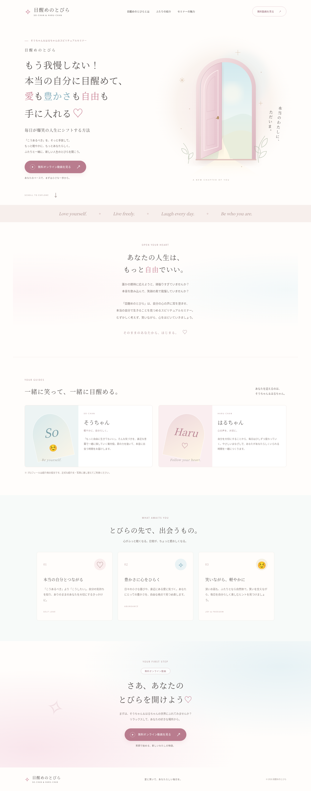

# 目醒めのとびら

そうちゃん＆はるちゃんのセミナー紹介ページ。白・淡いピンク・水色を使った、スマートフォン対応のランディングページです。



## 普通のブラウザでページを開く（GitHub Pages）

公開先のURL：**https://souchan558877.github.io/my-first-app/**

このURLは、下記のPages設定が有効になり、GitHubの公開処理が終わった後に使えます。404が表示される場合は、まだ公開が完了していません。GitHubのファイル一覧やCodexの「Index」タブは、公開したWebページとは異なる画面です。

### 最初の1回だけ行う設定

1. GitHubにログインし、[このリポジトリのPages設定](https://github.com/souchan558877/my-first-app/settings/pages)を開きます。
2. **Build and deployment** の **Source** で **Deploy from a branch** を選びます。
3. **Branch** で **main** を選び、その右側で **/ (root)** を選びます。
4. **Save** を押します。
5. 公開処理が完了すると、設定画面に **Visit site** が表示されます。それを押して完成ページを開きます。処理状況はリポジトリの **Actions** タブから確認できます。

リポジトリの上部から辿る場合は **Settings → 左側の Pages** の順に押します。Settingsが見えない場合は、リポジトリの管理権限を持つアカウントでログインしてください。

Pages設定に契約プランの制限が表示される場合は、GitHubの画面に案内された条件を確認してください。

## ZIPをダウンロードする

まずリポジトリを閲覧できるGitHubアカウントでログインしてください。ログイン前に404が出る場合があります。

[完成ページのZIPをダウンロード](https://github.com/souchan558877/my-first-app/raw/refs/heads/main/downloads/mezame-no-tobira.zip)

ボタンから辿る場合：

1. [リポジトリ](https://github.com/souchan558877/my-first-app)を開きます。
2. **downloads** フォルダ → **mezame-no-tobira.zip** を押します。
3. **Download raw file**（下向き矢印）を押します。
4. ダウンロードしたZIPを展開し、**mezame-no-tobira** フォルダ内の **index.html** をダブルクリックします。

リポジトリ全体を取得する場合は、緑色の **Code → Download ZIP** でもダウンロードできます。

CSS・画像・JavaScriptはHTMLに埋め込み済みなので、展開したindex.htmlだけでも完成ページが開きます。インターネット接続や追加のアプリは不要です。ソースコードが文字として開く場合は、ファイルを右クリックして **プログラムから開く → Chrome / Edge / Safari** を選んでください。

## 開発環境での表示

```sh
cd /workspace/my-first-app
python3 -m http.server 8000 --bind 0.0.0.0
```

このサーバーは開発用です。クラウド側のlocalhostは、手元のパソコンから直接開けません。通常のブラウザにはGitHub Pagesか、ZIPを展開したHTMLをご利用ください。

## 編集とZIPの更新

- 文章・プロフィール：`index.html`。プロフィールは仮文です。
- 色・レイアウト：`styles.css`。
- 無料動画：`script.js` の `VIDEO_URL` にHTTPSの動画URLを設定してください。未設定時は「準備中」と表示します。
- とびらの画像：`assets/door.svg`。

CSS・JavaScript・画像の変更後は、埋め込み内容を更新します。HTMLの文章は保持されます。

```sh
python3 build_preview.py
```

ZIPも更新する場合：

```sh
python3 package_site.py
```

Pythonの標準機能だけで動作します。ZIPには公開用のファイルだけを含め、Gitの内部データや認証情報は含めません。

## 表示確認とプレビューの違い

実ブラウザのChromiumで1440px・390px・320pxの画面幅を確認しました。背景色・ピンクのボタン・とびらの画像・動画ボタンの動作を検証済みです。ページ本体以外のCSS・JavaScript・画像のHTTPリクエストは発生しません。

以前のCSS・画像の相対パス依存は解消済みです。Codex内のプレビューは通常のブラウザとは表示方法が異なる場合があります。その画面が文字だけでも、公開サイトの表示結果と同じとは限りません。Pagesでの公開状態と公開URLの動作は、実際に公開完了してから確認してください。
